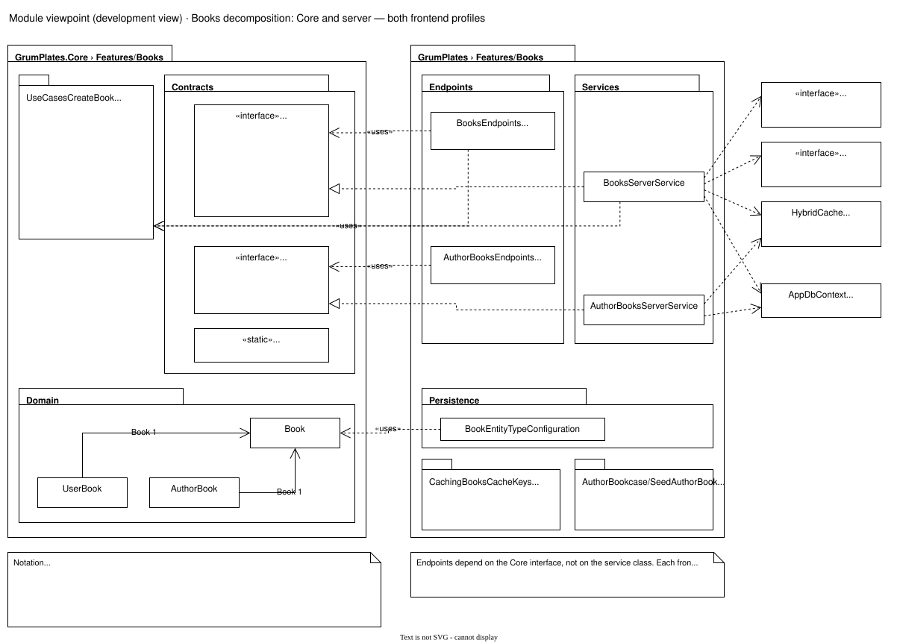
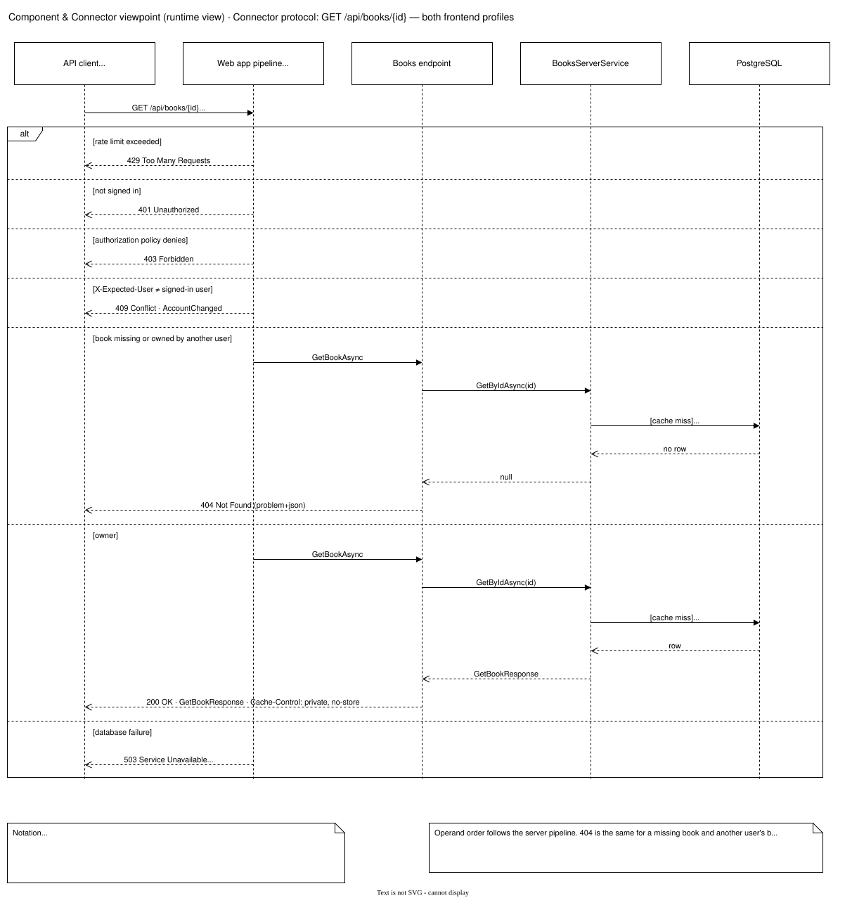
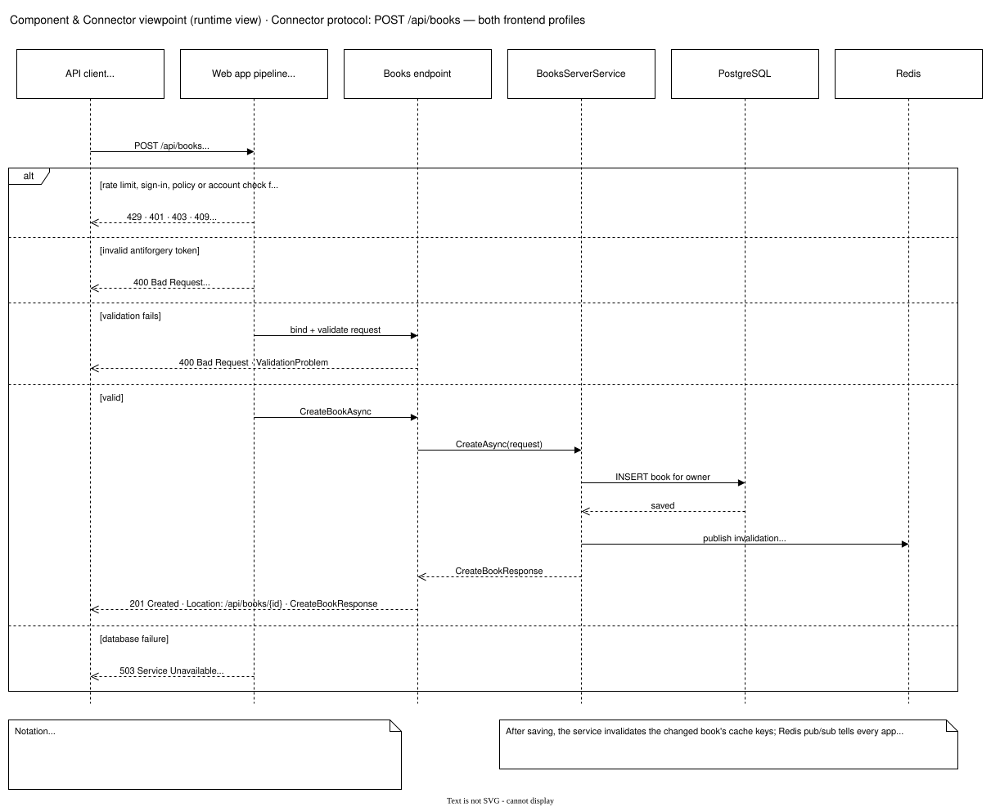
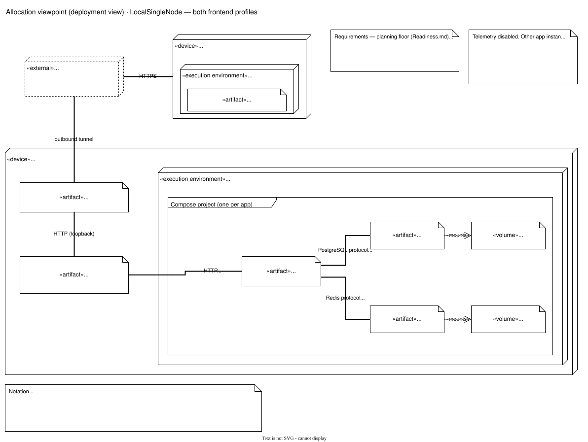
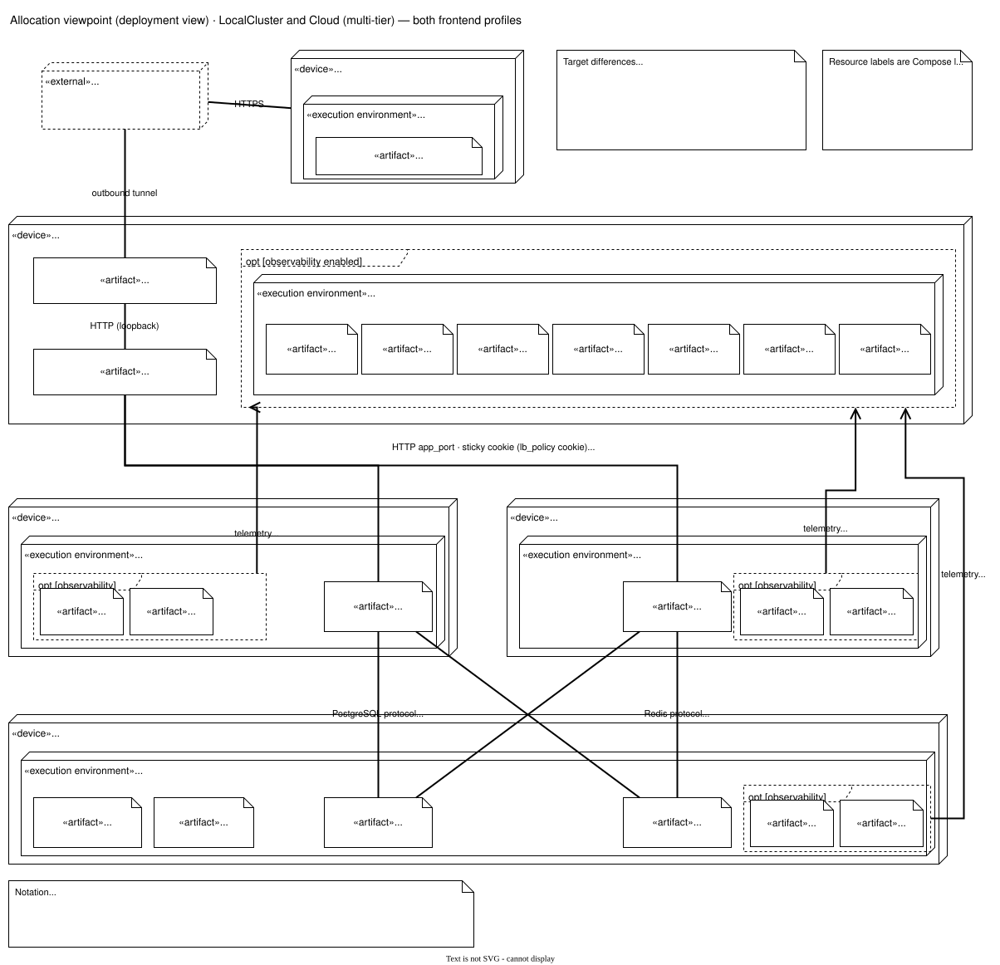

# Architecture illustrations

These diagrams describe GrumPlates with the **3+1 approach** to architecture description (Christensen, Corry and Hansen, "An Approach to Software Architecture Description Using UML"): three viewpoints (module, component & connector, allocation) plus the architecturally significant requirements that tie them together. [Architecture](../Architecture.md) gives the rules in prose; these views show the same structures.

## How to read these views

| Term | Meaning here |
| --- | --- |
| Viewpoint | The rules for a kind of view: its concerns, stakeholders, element and relation types. |
| View | One diagram of a structure, drawn for stakeholders. Each `.drawio.svg` file is one view. |
| Module viewpoint (development view) | How functionality maps to static development units: packages, classes and interfaces, related by association, generalization, realization and dependency. For architects and developers. Elements may be omitted when that communicates better. |
| Component & Connector (C&C) viewpoint (runtime view) | Runtime components (black-box units with a responsibility, the "what") and connectors (first-class communication paths, the "how"). A connector's **protocol** is the order of its operations, shown as a sequence diagram. The diagrams need the element catalogs in the profile READMEs. |
| Allocation viewpoint (deployment view) | Which hardware node each runtime element runs on (allocated-to), the protocol links between nodes and the resources involved. For maintainers, operators, developers and architects. |
| +1 | Architecturally significant requirements: scenarios (one path through a use case) and quality attributes. |

Patterns used: relaxed layering (every module arrow points towards `GrumPlates.Core`), client-server, shared data (PostgreSQL), publish-subscribe (Redis cache invalidation between app nodes) and multi-tier allocation.

A fork selects **one** frontend in `frontend-profile.txt`. Shared views show only what both profiles have in common and say "API client" or "Frontend assets (selected profile)" for the client. Profile views live in one folder per profile.

## Architecturally significant requirements (+1)

**S1 Create a private book.** A signed-in user opens the create form, enters title, author and URL, and saves. The client sends `POST /api/books` with the session cookie, `X-Expected-User` and `X-CSRF-TOKEN`. The server validates the request, stores the book for that owner, invalidates the cached entries on every app node, and returns 201. Views: the Books module decompositions ([Core and server](shared/module-books-core-and-server.drawio.svg), [Blazor client](blazorauto/module-books-client.drawio.svg) or [React client](react/module-books-client.drawio.svg)), the runtime view of the profile, the [create-book protocol](shared/cc-protocol-create-book.drawio.svg) and the [four-node allocation](shared/allocation-four-node.drawio.svg) (app node to data node).

**S2 Browse the public catalog.** An anonymous visitor opens the books page. Public data comes from `/api/author-books` (or from server rendering in BlazorAuto) through HybridCache; no credentials are sent. Views: the profile runtime view and the allocation views.

**S3 Another user's book.** A signed-in user requests a book id that someone else owns and receives 404, exactly as for a missing book. View: the [get-book protocol](shared/cc-protocol-get-book.drawio.svg).

| Quality attribute | Tactics | Where it shows |
| --- | --- | --- |
| Modifiability | Feature slices (Core, server and client per feature); swappable frontend profile; arrows point towards Core. | Module views |
| Availability | Two app nodes behind a health-checked load balancer; rolling app updates. | [Four-node allocation](shared/allocation-four-node.drawio.svg) |
| Security | Owner-scoped 404, antiforgery (400), captured-owner header (409), rate limits (429), `Cache-Control: private, no-store`, no public data-store ports. | Protocol and allocation views |
| Performance | HybridCache with Redis, bounded payloads, server rendering of public pages (BlazorAuto). | Runtime views |
| Deployability | One image, three deployment targets. | Allocation views |

## Shared views

### Books decomposition: Core and server

`GrumPlates.Core` owns the Books contracts, domain entities and request/response DTOs. The server realizes `IBooksApi` and `IAuthorBooksApi` with services that use `AppDbContext`, `HybridCache`, `ICacheInvalidator` and the Accounts `ICurrentUserAccessor`. Endpoints depend on the Core interfaces, not on the service classes, which is what lets each frontend profile add its own realization.

### Connector protocols of the Books API

The `alt` operands follow the server pipeline in `GrumPlates/Program.cs`: account request policies wrap the rest (persistence failures become 503), then authentication, rate limiting, authorization, the account principal guard and antiforgery, then the endpoint. A book that belongs to another user returns the same 404 as a missing book.

Writes add the antiforgery check and request validation. After saving, the service invalidates the changed book's cache keys locally and publishes the invalidation through Redis so the other app nodes drop them too.

The complete, CI-checked contract is [`openapi.json`](../../GrumPlates.React/api/openapi.json). Books operations and their responses:

| Operation | Route | Responses |
| --- | --- | --- |
| ListBooks | `GET /api/books` | 200 401 403 409 429 503 |
| SearchBooks | `GET /api/books/search` | 200 400 401 403 409 429 503 |
| GetBook | `GET /api/books/{id}` | 200 401 403 404 409 429 503 |
| CreateBook | `POST /api/books` | 201 400 401 403 409 429 503 |
| UpdateBook | `PUT /api/books/{id}` | 204 400 401 403 404 409 429 503 |
| DeleteBook | `DELETE /api/books/{id}` | 204 401 403 404 409 429 503 |
| ListAuthorBooks | `GET /api/author-books` | 200 429 |
| GetAuthorBook | `GET /api/author-books/{id}` | 200 404 429 |

| Code | When |
| --- | --- |
| 200 / 201 / 204 | Success. 201 sets `Location: /api/books/{id}`. Private responses are `Cache-Control: private, no-store`. |
| 400 | Validation problem; route/body id mismatch on PUT; invalid antiforgery token on writes (`CsrfInvalid`). |
| 401 | Not signed in. API paths get 401 instead of a login redirect. |
| 403 | An authorization policy denies a signed-in user (never a redirect on API paths). |
| 404 | The book does not exist **or belongs to another user**, so private records are not revealed. |
| 409 | `X-Expected-User` is missing or is not the signed-in user (`AccountChanged`: the account changed in another tab). |
| 429 | Rate limit (API default 60 requests per minute per client IP). |
| 503 | Database or persistence failure during the request (`AccountServiceUnavailable`). |

### Allocation

**LocalSingleNode** runs everything on one Linux PC: host services Caddy and cloudflared, and one Docker Compose project per app with `web`, `postgres` and `redis`. Other app instances can share Caddy, cloudflared and Docker. The requirements note shows the readiness planning floors, not measured capacity.

**LocalCluster** (four PCs on a LAN) and **Cloud** (four Hetzner servers provisioned with OpenTofu and Ansible) share the same tiers: a main node with the tunnel, the load balancer and the optional observability backend; two app nodes running `web`; and a data node with PostgreSQL and Redis. In Cloud only the main node has public networking. Resource labels are Compose limits. See [deployment](../../Deployment/README.md) for the targets.

## Frontend profile views

- [BlazorAuto profile views](blazorauto/README.md): package overview, Blazor Books client and runtime with server rendering, SignalR and WebAssembly.
- [React profile views](react/README.md): package overview with the generated contract, React Books client and runtime with the static SPA host.

A fork that removes a frontend deletes that profile's folder and this link.

## Editing diagrams

Each `.drawio.svg` file is both the rendered image and the editable diagram. Open it in draw.io desktop or the VS Code "Draw.io Integration" extension and save in place. Keep the default colours so the diagrams follow light and dark mode, keep one page per file, and never add IP addresses, ports, hostnames other than template role names, or secrets. The [illustrations plan](../../Plans/ArchitectureIllustrations.md) has the export command, drawing conventions and validator.
