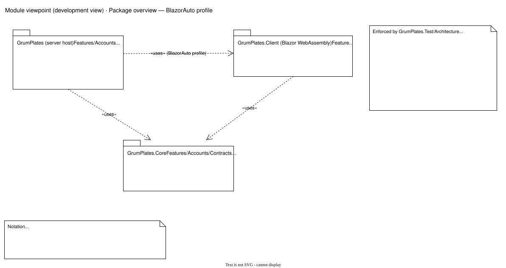
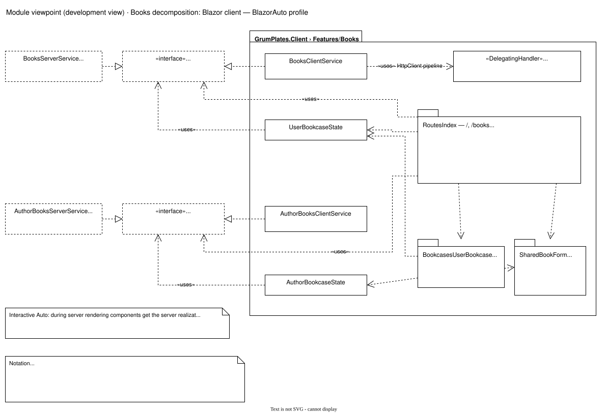
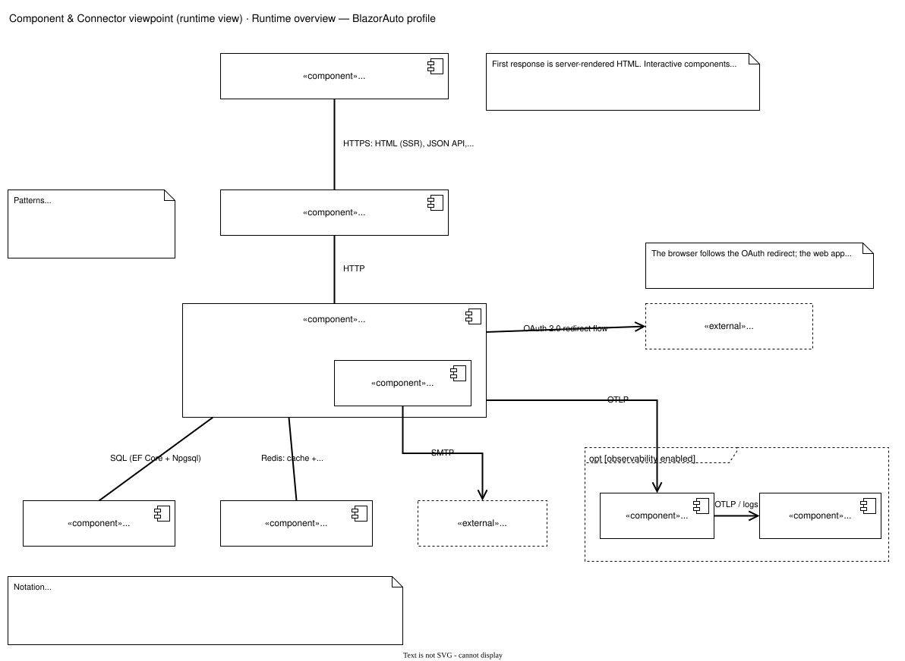

# BlazorAuto profile views

These views apply when `frontend-profile.txt` selects `BlazorAuto`. Terminology and the shared views are in the [illustrations overview](../README.md).

## Package overview

The server host references `GrumPlates.Client` only in this profile, and both reference `GrumPlates.Core`. `GrumPlates.Test` (omitted) references all three. Rules enforced by `GrumPlates.Test/Architecture`:

- Core does not reference ASP.NET Core or EF Core.
- Client does not reference EF Core or Npgsql, and references Core but not the server.
- Request/response DTOs live only in Core (`UseCases` or Account `Contracts`); Core API interfaces live in `Contracts`.
- Blazor components do not inject `HttpClient`; the server exposes no `HttpClient` surface.
- Every Core API interface has a server and a client implementation.
- Entity configurations live under feature `Persistence` namespaces and target Core domain entities.

## Books client decomposition

Components reach the API only through the Core interfaces and feature state. During server rendering (prerender and interactive server) dependency injection gives them `BooksServerService` directly. In WebAssembly it gives them `BooksClientService` and `AuthorBooksClientService`, registered in `GrumPlates.Client/Program.cs`, which call the JSON API over an `HttpClient` whose `BooksAntiforgeryHandler` adds `X-Expected-User` and `X-CSRF-TOKEN` to private requests. Route components inject the interfaces and `UserBookcaseState`; the bookcase components on the index page use the two bookcase states.

## Runtime (C&C) overview

Element catalog: components.

| Component | Responsibility | Source |
| --- | --- | --- |
| Browser: Blazor WebAssembly client | Shows server-rendered HTML, then runs interactive components over the SignalR circuit and later in WebAssembly. | `GrumPlates.Client` |
| Reverse proxy | Edge HTTP proxy; load balances app nodes in four-node targets. | `Deployment/*/ansible/roles/*caddy*/templates/app.caddy.j2` |
| Web app | Serves server-rendered pages, the interactive server circuit, WebAssembly assets, JSON APIs under `/api` and health under `/health`; runs feature services. Account pages are server-rendered Razor Identity pages under `/Account`. | `GrumPlates/Program.cs` |
| Account mail outbox worker | Hosted service in the web app; sends queued account email. | `GrumPlates/Features/Accounts/Email/AccountMailOutboxWorker.cs` |
| PostgreSQL | Books, identity, mail outbox and Data Protection keys. | `GrumPlates/Infrastructure/Persistence` |
| Redis | HybridCache second level and the pub/sub channel for cache invalidation between app nodes. | `GrumPlates/Infrastructure/Hosting/CacheInvalidation` |
| SMTP server «external» | Delivers account email. | `GrumPlates/Features/Accounts/Email/AccountMailTransport.cs` (MailKit) |
| Google OAuth «external», optional | Optional external sign-in. The package is referenced only in this profile. | `GrumPlates/Features/Accounts/Blazor/BlazorIdentityServiceCollectionExtensions.cs` |
| Alloy agent, observability backend (optional) | Receive and store telemetry. | [Observability architecture](../../Observability/Architecture.md) |

Element catalog: connectors.

| Connector | Protocol | Notes |
| --- | --- | --- |
| Browser ↔ reverse proxy ↔ web app | HTTPS to the edge, HTTP behind it | Carries server-rendered HTML (public data passed with `PersistentComponentState`), the SignalR WebSocket circuit, WebAssembly assets and JSON API calls. Cookie authentication; private APIs need `X-Expected-User` and `X-CSRF-TOKEN`. |
| Web app → PostgreSQL | SQL over the PostgreSQL wire protocol (EF Core + Npgsql) | Shared-data pattern. |
| Web app ↔ Redis | Redis protocol: cache get/set, publish/subscribe invalidation | Publish-subscribe pattern. |
| Outbox worker → SMTP | SMTP (MailKit) | |
| Web app → Google | OAuth 2.0 redirect flow | The browser follows the redirect; the web app exchanges the code. |
| Web app → Alloy → backend | OTLP | Optional; must fail open. |
