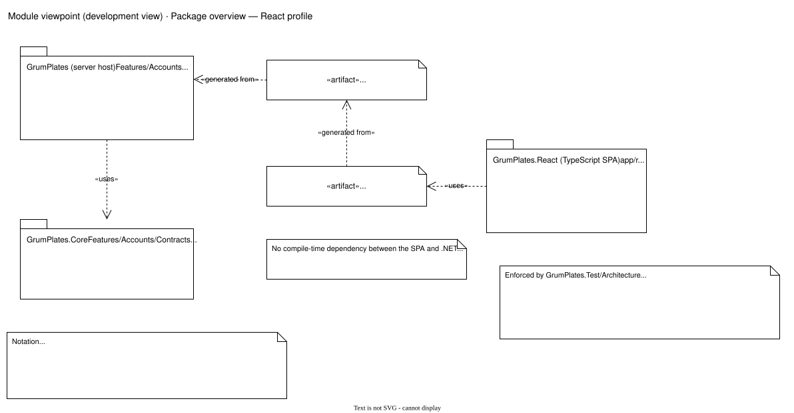
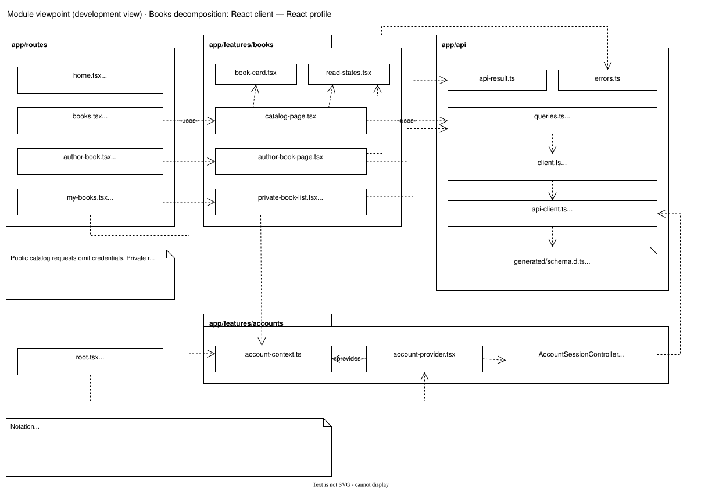
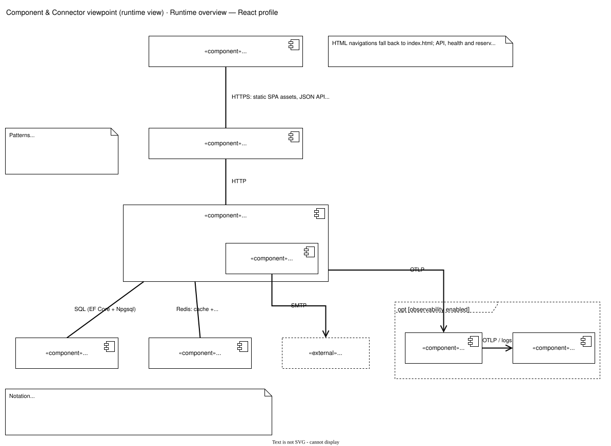

# React profile views

These views apply when `frontend-profile.txt` selects `React`. Terminology and the shared views are in the [illustrations overview](../README.md).

## Package overview

The SPA has no compile-time dependency on any .NET project. `scripts/openapi-contract.mjs` generates `GrumPlates.React/api/openapi.json` from the server and `app/api/generated/schema.d.ts` from that file; CI checks that both are current. `GrumPlates.Test` (omitted) references the .NET projects. Rules enforced by `GrumPlates.Test/Architecture` for Core and the server:

- Core does not reference ASP.NET Core or EF Core.
- Request/response DTOs live only in Core (`UseCases` or Account `Contracts`); Core API interfaces live in `Contracts`.
- The server exposes no `HttpClient` surface.
- Entity configurations live under feature `Persistence` namespaces and target Core domain entities.

## Books client decomposition

Every request goes through an `openapi-fetch` client created in `app/api/api-client.ts` and typed by the generated schema. Public catalog pages use TanStack Query (`queries.ts`) and the public client in `client.ts`, which omits credentials. Private features read the account context that `account-provider.tsx` (mounted in `root.tsx`) supplies; its `AccountSessionController` decorates requests with the session cookie, `X-Expected-User` and `X-CSRF-TOKEN`. `api-result.ts` and `errors.ts` turn responses into results and safe errors. Accounts are disabled by default in this profile (see [frontend profiles](../../FrontendProfiles.md)), so the private part appears only when enabled.

## Runtime (C&C) overview

Element catalog: components.

| Component | Responsibility | Source |
| --- | --- | --- |
| Browser: React SPA | Renders all pages in the browser and calls the JSON API. | `GrumPlates.React/app` |
| Reverse proxy | Edge HTTP proxy; load balances app nodes in four-node targets. | `Deployment/*/ansible/roles/*caddy*/templates/app.caddy.j2` |
| Web app | Serves the static SPA (HTML navigations fall back to `index.html`; API, health and reserved account paths never do), JSON APIs under `/api` and health under `/health`; runs feature services. No server rendering and no Node server in the image. | `GrumPlates/Program.cs`, `GrumPlates/Frontend/ReactFrontendHosting.cs` |
| Account mail outbox worker | Hosted service in the web app; sends queued account email. | `GrumPlates/Features/Accounts/Email/AccountMailOutboxWorker.cs` |
| PostgreSQL | Books, identity, mail outbox and Data Protection keys. | `GrumPlates/Infrastructure/Persistence` |
| Redis | HybridCache second level and the pub/sub channel for cache invalidation between app nodes. | `GrumPlates/Infrastructure/Hosting/CacheInvalidation` |
| SMTP server «external» | Delivers account email. | `GrumPlates/Features/Accounts/Email/AccountMailTransport.cs` (MailKit) |
| Alloy agent, observability backend (optional) | Receive and store telemetry. | [Observability architecture](../../Observability/Architecture.md) |

Element catalog: connectors.

| Connector | Protocol | Notes |
| --- | --- | --- |
| Browser ↔ reverse proxy ↔ web app | HTTPS to the edge, HTTP behind it | Static SPA assets, `GET /api/client-config`, the public catalog under `/api/author-books` without credentials and, when accounts are enabled, `/api/auth/*` and `/api/books` with the cookie, `X-Expected-User` and `X-CSRF-TOKEN`. |
| Web app → PostgreSQL | SQL over the PostgreSQL wire protocol (EF Core + Npgsql) | Shared-data pattern. |
| Web app ↔ Redis | Redis protocol: cache get/set, publish/subscribe invalidation | Publish-subscribe pattern. |
| Outbox worker → SMTP | SMTP (MailKit) | |
| Web app → Alloy → backend | OTLP | Optional; must fail open. |
